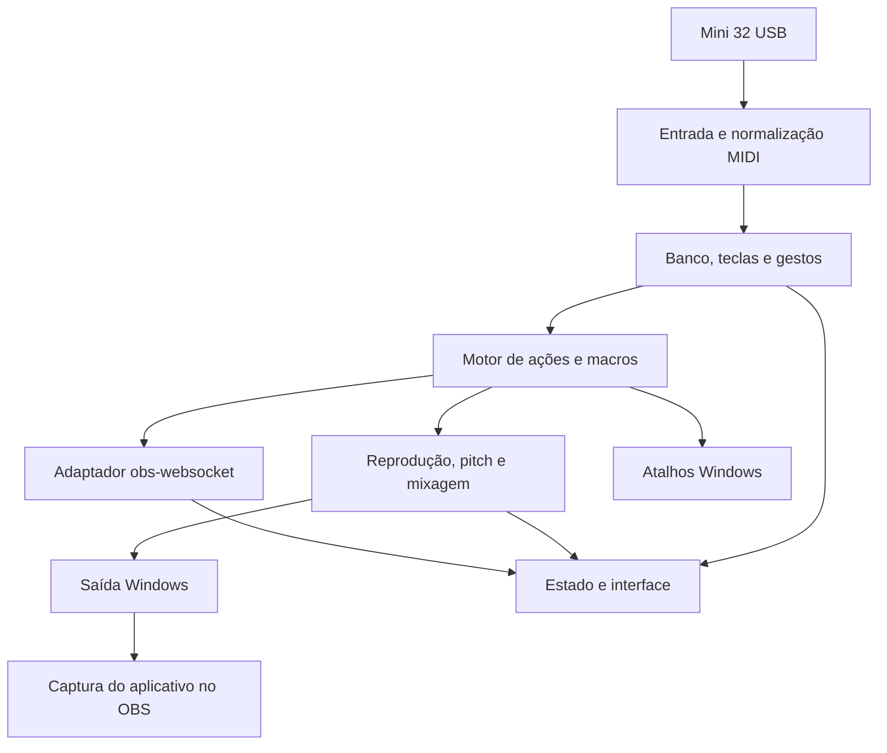

# Arquitetura e decisões técnicas

Versão 0.1 — 08/10/2026. Arquitetura proposta, sujeita às provas técnicas.

## Fluxo

## Tecnologia candidata

| Componente | Proposta | Condição |
|---|---|---|
| Interface | Flutter para Windows, preferência expressa pelo usuário | Validar ferramentas, integração e desempenho no PC de referência |
| Motor de ações/áudio | C#/.NET, evoluindo os componentes testados | Separar lógica da interface experimental e definir comunicação local |
| MIDI e saída de áudio | NAudio ou adaptadores nativos equivalentes | Testar dispositivo, latência e reconexão |
| Pitch | Biblioteca DSP, com SoundTouch como candidata | Medir qualidade/CPU/atraso e revisar licença |
| OBS | Cliente obs-websocket compatível com o protocolo instalado | Confirmar capacidades em execução |
| Configuração | JSON versionado e escrita atômica | Recuperação após falha e migrações |
| Biblioteca | Pasta de áudios importados + catálogo por identificador | Nomes repetidos e portabilidade |

Nenhuma versão de dependência está fixada. O desenho não exige plugin nativo próprio no OBS nem driver HID virtual.

Atualização após aprovação da bancada: Flutter substitui WPF como preferência para a interface do produto. Os protótipos WinForms continuam como referências de validação. A integração Flutter/motor é uma proposta ainda não implementada; ver [direção de interface](08-interface-flutter.md). O DSP/NAudio já possui versão fixada na bancada experimental, mas a seleção definitiva do produto permanece aberta.

## Separação de responsabilidades

- Entrada MIDI identifica dispositivo, canal, tipo e número do evento. Tratar Note On com velocidade zero como liberação, quando aplicável.
- Mapeamento converte eventos em ações e acompanha teclas mantidas, sem executar áudio na interface.
- Motor de ações cuida de ordem, cancelamento, gestos, confirmação e macros.
- Adaptador OBS consulta capacidades/alvos, recebe eventos e não repete ações antigas após reconectar.
- Motor de áudio separa leitura/decodificação, efeitos por reprodução, grupos e mixagem final.
- Callback de áudio não deve fazer acesso a disco, rede ou operações demoradas da interface.
- Interface exibe estado observado, distinguindo comando solicitado de operação confirmada.

## Modelo de dados proposto

| Entidade | Campos principais |
|---|---|
| Configuração | versão do esquema, preferências, banco ativo, conexões |
| Dispositivo MIDI | identificação, calibração e vínculos aprendidos |
| Banco | ID, nome, vínculos das teclas |
| Vínculo | evento MIDI, tecla visual, gesto, ID da ação |
| Ação | ID, tipo, nome, parâmetros |
| Macro | ID, etapas, política de erro, cancelamento |
| Áudio | ID, caminho interno, metadados, duração |
| Configuração de vinheta | áudio, volume, trecho, loop, fades, grupo, pitch |
| Grupo | ID, exclusivo ou mixável, volume e redução automática |
| Reprodução ativa | ID da instância, ação de origem, estado, posição, pitch |

Reprodução ativa é estado transitório e não volta a tocar ao reabrir o app. Credenciais OBS não devem entrar no arquivo de exportação comum; usar armazenamento protegido do Windows.

## Decisões e limites

| ID | Decisão | Estado |
|---|---|---|
| D-01 | Controle direto do OBS, sem atalhos para operações nativas | Confirmado |
| D-02 | Áudio processado no app e capturado pelo OBS | Confirmado; captura a validar |
| D-03 | Aplicativo desktop Windows com recursos separados em módulos | Proposto |
| D-04 | Bancos por botões de oitava somente com identificação confiável | A validar |
| D-05 | Redução de música inicialmente dentro do mixer do aplicativo | Proposto |
| D-06 | Limite de vozes e cache definidos por medição no i3-2120 | A validar |

32 teclas com transposição por oitavas produzem faixas sobrepostas. Se os botões apenas alterarem a nota e não enviarem evento observável, não inferir banco/posição física a partir da nota isolada.

Arquivos longos deverão usar leitura em fluxo quando suportado. Sons curtos podem ser preparados em cache limitado. Número máximo de vozes, tamanho do buffer e taxa de amostragem serão definidos por teste, sem promessa de latência zero.

## Referências técnicas consultadas no planejamento

- [OBS: integração do obs-websocket](https://obsproject.com/blog/obs-studio-and-obs-websocket-join-forces)
- [OBS: protocolo](https://github.com/obsproject/obs-websocket/blob/master/docs/generated/protocol.md)
- [OBS: captura de áudio do aplicativo](https://obsproject.com/kb/application-audio-capture-guide)
- [Windows: SendInput e suas restrições](https://learn.microsoft.com/en-us/windows/win32/api/winuser/nf-winuser-sendinput)
- [NAudio](https://github.com/naudio/NAudio)
- [SoundTouch](https://soundtouch.surina.net/README.html)

Essas referências orientam a seleção; não comprovam compatibilidade das versões ainda não escolhidas com a máquina do usuário.
